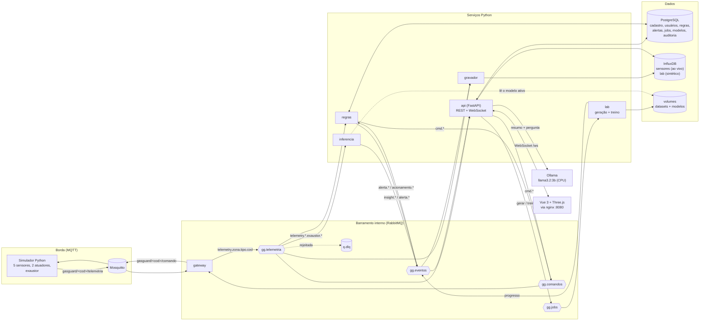

# Gas-Guard

Monitoramento de vazamento de gás (GLP) em cozinha comercial, com
**manutenção preditiva do exaustor da coifa**: Web + IoT + Inteligência
Artificial, tudo subindo com um comando.

Trabalho da disciplina **Desenvolvimento de Software para Web II**, 3º ano de
Engenharia de Software. Esta é a **2ª entrega**: o protótipo do 1º bimestre
(ESP32 → MQTT → InfluxDB → Vue) virou uma aplicação AIoT completa.

---

## O problema

Em cozinhas com botijão de GLP, a detecção de vazamento depende de alguém
**sentir o cheiro**. Isso falha justamente quando importa: de madrugada, com a
cozinha vazia, ou num ambiente comercial cheio de outros odores. O GLP tem
limite inferior de explosividade (LEL) perto de **19.000 ppm**; até lá nada
acontece, e a partir dali qualquer faísca basta.

O sistema mede o gás a cada 2 segundos e age sozinho:

| Faixa | Concentração | O que acontece |
| --- | --- | --- |
| Normal | < 1.000 ppm | nada |
| Atenção | 1.000 – 1.999 ppm | o **exaustor** liga sozinho, se estiver desligado |
| Crítico | ≥ 2.000 ppm (~10% do LEL) | a **válvula solenoide fecha** o gás e a **sirene** liga |

**O que a 2ª entrega acrescenta: o exaustor.** Ele é a última linha de defesa:
é ele que tira o gás da cozinha. Se o motor dele estiver gasto e parar
justamente durante um vazamento, o gás acumula. Por isso o exaustor é o
**equipamento monitorado**: vibração, corrente, temperatura do motor e rotação
alimentam dois modelos de regressão que preveem a **saúde** (0 a 100) e a
**vida útil restante** (horas até a falha) dele, com alertas antes da quebra.

---

## Arquitetura



Mais detalhes (por que cada peça existe, as decisões e os cuidados) em
[`docs/ARCHITECTURE.MD`](docs/ARCHITECTURE.MD).

### Os três fluxos

**IoT → Web.** O simulador publica no Mosquitto → o `gateway` valida, carimba
o horário, embrulha no envelope e republica no RabbitMQ (`gg.telemetria`,
routing key `telemetry.cozinha.gas.GAS-01`) → o `gravador` grava no InfluxDB,
e a `api` recebe pela fila `q.websocket` e entrega ao navegador pelo
WebSocket → painel e cena 3D se atualizam.

**Web → IoT.** Botão no painel → `POST /api/dispositivos/VALVULA-01/comandos`
→ a API publica em `gg.comandos` → `gateway` → MQTT
`gasguard/VALVULA-01/comando` → o simulador fecha a válvula → a vazão de gás
cai a zero **na leitura seguinte**, que volta pelo fluxo de cima.

**IA.** O **Laboratório** gera milhões de leituras sintéticas (fila
`q.jobs.gerar`) → o **Treinamento** cria os modelos (fila `q.jobs.treinar`) →
a `inferencia` aplica o modelo ativo à telemetria do exaustor que chega pelo
RabbitMQ → publica `insight.*` (saúde, vida útil, tendência) e `alerta.*` (com
histerese) → painel Insights e cor do exaustor na cena 3D.

### Os containers

| Serviço | O que faz |
| --- | --- |
| `frontend` | nginx sem root: serve o Vue e repassa `/api` e `/ws`. **Única porta da aplicação publicada (8080).** |
| `api` | FastAPI: REST, WebSocket, login JWT, rotas de IA, Mensageria e assistente |
| `gateway` | Ponte MQTT ↔ RabbitMQ nos dois sentidos |
| `gravador` | Fila `q.gravador` → InfluxDB, em lote |
| `regras` | Regras de negócio (atuador automático) e dono da tabela de alertas |
| `inferencia` | Modelos de regressão sobre a telemetria ao vivo; troca de versão sem reiniciar |
| `lab` | Jobs demorados: geração de dados e treino |
| `simulador` | O dispositivo: sensores, atuadores e exaustor, via MQTT |
| `migrador` | Roda as migrations (Alembic) e o seed, e termina; os outros esperam por ele |
| `mosquitto`, `rabbitmq`, `postgres`, `influx` | brokers e bancos |
| `ollama` + `ollama-init` | LLM local; o init baixa o modelo na primeira subida |
| `adminer` | interface web do PostgreSQL (só em 127.0.0.1) |

O backend é **uma imagem só** (`backend/`), com um comando diferente por
serviço. O modelo físico do exaustor e da cozinha (`comum/fisica.py`) é
compartilhado entre o simulador e o gerador do Laboratório.

---

## Dispositivos

| Código | Categoria | Mede ou faz |
| --- | --- | --- |
| `GAS-01` | sensor | concentração de GLP (ppm), perto do piso (GLP é mais pesado que o ar) |
| `TEMP-01` | sensor | temperatura da cozinha (°C) |
| `UMID-01` | sensor | umidade (%) |
| `LUZ-01` | sensor | luz na janela (lx): é o dia e a noite da cena 3D |
| `VAZAO-01` | sensor | vazão de gás no cano (m³/h) |
| `VALVULA-01` | atuador | abre/fecha o gás. **Fecha sozinha** em 2.000 ppm; o operador reabre pelo painel |
| `SIRENE-01` | atuador | liga sozinha em 2.000 ppm e desliga abaixo de 1.000 |
| `EXAUSTOR-01` | **equipamento** + atuador | liga/desliga (pelo painel e pela regra de 1.000 ppm) e mede **vibração, corrente, temperatura do motor e rotação** |

As regras ficam no PostgreSQL e são editáveis na página **Regras e limites**:

| Regra | Condição | Ação |
| --- | --- | --- |
| Gás em atenção liga o exaustor | `GAS-01.ppm >= 1000` | ligar `EXAUSTOR-01` |
| Gás crítico fecha a válvula | `GAS-01.ppm >= 2000` | fechar `VALVULA-01` |
| Gás crítico liga a sirene | `GAS-01.ppm >= 2000` | ligar `SIRENE-01` |
| Gás normalizado desliga a sirene | `GAS-01.ppm < 1000` | desligar `SIRENE-01` |
| Cozinha muito quente liga o exaustor | `TEMP-01.temperatura > 38` | ligar `EXAUSTOR-01` |

---

## Como rodar

### Pré-requisitos

- **Docker Desktop** com pelo menos **8 GB de memória** para o WSL2. No
  Windows, crie `C:\Users\<você>\.wslconfig` com:

  ```ini
  [wsl2]
  memory=10GB
  ```

  e rode `wsl --shutdown` antes de abrir o Docker Desktop.
- Python 3 para gerar os segredos (ou use o comando com Docker abaixo).
- Na primeira subida, cerca de **2 GB** de download do modelo de linguagem.

### Subir

```bash
python scripts/gerar_segredos.py
docker compose up -d --build
```

Sem Python na máquina, o primeiro comando vira:

```bash
docker run --rm -v "${PWD}:/w" -w /w python:3.13-slim python scripts/gerar_segredos.py
```

O script cria o `.env`, `secrets/rabbitmq/definitions.json` e
`secrets/usuarios-demo.txt` (tudo fora do Git). Rodar de novo só completa o
que falta: não troca senhas que os bancos já gravaram no volume.

Acompanhe com `docker compose ps`: todos ficam `healthy` (o `migrador` e o
`ollama-init` terminam com `Exited (0)`, de propósito).

| O quê | Endereço |
| --- | --- |
| **Aplicação** | **http://localhost:8080** |
| Documentação da API (Swagger) | http://localhost:8080/api/docs |
| RabbitMQ (gerenciamento) | http://127.0.0.1:15672 |
| InfluxDB | http://127.0.0.1:8086 |
| Adminer (PostgreSQL) | http://127.0.0.1:8081 |
| MQTT (só leitura, `gg_observador`) | 127.0.0.1:1883 |

As interfaces de administração escutam só em `127.0.0.1`. Os links também
estão na página **Infraestrutura** da aplicação, e as credenciais em
`secrets/usuarios-demo.txt`.

Para começar do zero (apaga **todos** os dados):

```bash
docker compose down -v
python scripts/gerar_segredos.py --refazer
docker compose up -d --build
```

### Usuários de demonstração

| Usuário | Papel | Pode |
| --- | --- | --- |
| `visualizador` | visualizador | ver tudo, perguntar ao assistente |
| `operador` | operador | + comandar atuadores e o simulador (vazamento, falha, pausa) |
| `administrador` | administrador | + gerar dados, treinar modelos, editar cadastros e regras, ver a auditoria |

As senhas são aleatórias, geradas pelo script, e ficam em
`secrets/usuarios-demo.txt`. Nenhuma senha está no repositório.

---

## Roteiro da demonstração

O passo a passo completo, com o que mostrar e o que falar em cada etapa, está
em [`docs/ROTEIRO.MD`](docs/ROTEIRO.MD). Em resumo, na ordem pedida:

1. `docker compose up -d --build` e `docker compose ps` com tudo saudável.
2. Login com os três papéis (o visualizador não vê botões; a API devolve 403).
3. Simulador publicando no Mosquitto:
   `docker compose exec mosquitto mosquitto_sub -u gg_observador -P <senha> -t 'gasguard/#' -v`.
4. Swagger em `/api/docs` (botão **Authorize** faz login).
5. **Mensageria**: filas, consumidores e `docker compose stop gravador` →
   `q.gravador` cresce → `docker compose start gravador` → esvazia.
6. InfluxDB (Data Explorer, bucket `sensores`) e PostgreSQL (Adminer: tabelas
   `dispositivos`, `regras`, `auditoria`); histórico no painel.
7. **Painel** atualizando por WebSocket.
8. **Vazamento forte** com o exaustor desligado: a regra liga o exaustor em
   1.000 ppm e fecha a válvula em 2.000 ppm; o operador reabre a válvula
   pelo botão.
9. **Laboratório**: gerar dados (padrão: ~7,5 milhões de leituras, ~1 min).
10. **Treinamento**: treinar e ler as métricas contra a base simples.
11. **Insights**: injetar falha de rolamento; saúde e vida útil caem, alertas
    abrem; no **Gêmeo 3D** o exaustor fica amarelo/vermelho e treme.
12. **Assistente**: "O exaustor tem algum alerta? O que devo fazer?"

---

## Onde está cada requisito

| Requisito | Onde |
| --- | --- |
| Vue 3 + TypeScript + Vite | `frontend/` |
| FastAPI + REST | `backend/app/*/router.py`, docs em `/api/docs` |
| WebSocket com ticket de uso único | `backend/app/tempo_real/` |
| MQTT nos dois sentidos | `simulador/simulador.py`, `backend/app/servicos/gateway.py` |
| ≥ 3 sensores, ≥ 2 atuadores, equipamento com ≥ 3 variáveis | tabela de dispositivos acima |
| Atuador por regra / atuador pela Web | `backend/app/servicos/regras.py` / `POST /api/dispositivos/{codigo}/comandos` |
| RabbitMQ: exchange topic, ≥ 4 filas, jobs, DLQ, usuário por serviço | `infra/rabbitmq/topologia.json` |
| Página Mensageria (via API de gerenciamento) | `backend/app/mensageria/router.py`, `MensageriaView.vue` |
| PostgreSQL e InfluxDB com papéis distintos | `backend/app/*/models.py`, `backend/app/core/influx.py` |
| Cena 3D movida por dados | `frontend/src/cena/CenaCozinha.ts` |
| Gerador sintético configurável | `backend/app/lab/gerador.py`, `LaboratorioView.vue` |
| 2 modelos de regressão com métricas e base | `backend/app/ia/treino.py`, `TreinamentoView.vue` |
| Mesmas features no treino e na inferência | `backend/app/ia/features.py` |
| Insights em tempo real com histerese | `backend/app/servicos/inferencia.py`, `InsightsView.vue` |
| LLM local com streaming | `backend/app/assistente/`, serviço `ollama` |
| JWT, 3 papéis, bcrypt, limite de tentativas, auditoria | `backend/app/auth/`, `backend/app/auditoria/` |
| Segredos fora do Git | `scripts/gerar_segredos.py`, `.gitignore` |
| Containers sem root, healthchecks, ordem de subida | `backend/Dockerfile`, `docker-compose.yml` |

---

## Estrutura

```
gas-guard
 |- backend/                 FastAPI e os serviços de fundo (uma imagem)
 |   |- alembic/             migrations do PostgreSQL
 |   \- app/
 |       |- auth/ auditoria/ ambientes/ dispositivos/ leituras/ regras/ alertas/
 |       |- mensageria/      envelope, topologia, conexão aio-pika, página Mensageria
 |       |- tempo_real/      WebSocket, tickets, hub, conexão da API com o RabbitMQ
 |       |- lab/             gerador de dados sintéticos e jobs
 |       |- ia/              features, treino, registro de modelos, Insights
 |       |- assistente/      LLM local: contexto, cliente do Ollama, rota com streaming
 |       |- servicos/        gateway, gravador, regras, inferencia, lab
 |       |- seed.py          usuários, cozinha, dispositivos e regras iniciais
 |       \- main.py          a API
 |- comum/fisica.py          modelo físico da cozinha e do exaustor (simulador + laboratório)
 |- simulador/               o dispositivo (Python + MQTT)
 |- frontend/                Vue 3 + TS + Vite, Chart.js, Three.js, Pinia
 |- infra/                   Mosquitto (senhas, ACL) e RabbitMQ (topologia)
 |- scripts/gerar_segredos.py
 |- firmware/                ESP32 do 1º bimestre (legado; o simulador o substitui)
 \- docs/                    arquitetura, roteiro, enunciados
```

---

## Desenvolvimento fora do Docker

Com a infraestrutura no compose (`postgres`, `influx`, `mosquitto`,
`rabbitmq`), cada serviço roda na máquina com as variáveis do `.env` mais as
do serviço (veja o bloco `environment` dele no `docker-compose.yml`). A pasta
`comum/` precisa estar no `PYTHONPATH`. O frontend roda com `npm run dev`; o
`vite.config.ts` repassa `/api` e `/ws` para `localhost:8000`.

---

## Limitações conhecidas

- **Tempo acelerado no exaustor.** Ao vivo, cada leitura do exaustor vale 5
  minutos de operação, para uma falha caber na apresentação. A vida útil
  prevista é em horas de operação simuladas.
- **A vida útil é mais difícil que a saúde.** No começo do desgaste os
  sensores quase não mudam; o modelo vence a base com folga no geral, mas
  erra mais no meio da degradação (a página de Treinamento mostra isso na
  linha "só máquinas degradando").
- **A referência da máquina fica na memória da inferência.** Se o serviço
  `inferencia` reiniciar com o exaustor já desgastado, ele toma esse estado
  como "normal" e passa a prever uma saúde mais otimista que a real, até a
  próxima manutenção (`Reparar`). Na demonstração, injete a falha com o
  serviço já rodando há alguns minutos.
- **Defeito de sensor pode parecer desgaste.** Uma deriva de sensor abaixa a
  saúde prevista; o treino inclui esses casos, mas não os separa
  completamente.
- **LLM em CPU.** A primeira resposta demora mais (o modelo é pré-carregado
  ao subir, mas o prompt ainda precisa ser processado).
- **Hub do WebSocket em memória.** A API roda com um processo; com várias
  réplicas, o estado ao vivo e os tickets precisariam de um armazenamento
  compartilhado.
